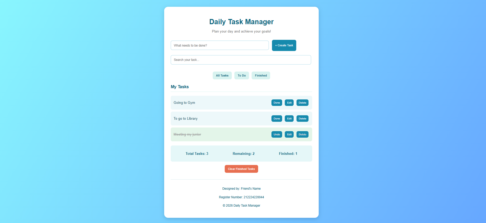
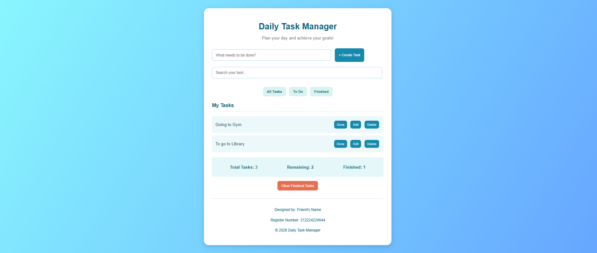
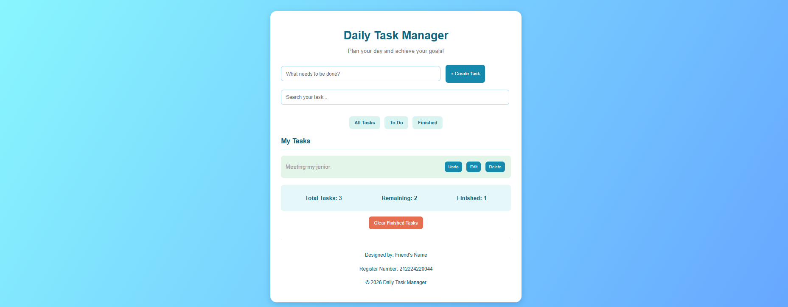

# Ex03 To-Do List using JavaScript
## Date:17-11-2026

## AIM
To create a To-do Application with all features using JavaScript.

## ALGORITHM
### STEP 1
Build the HTML structure (index.html).

### STEP 2
Style the App (style.css).

### STEP 3
Plan the features the To-Do App should have.

### STEP 4
Create a To-do application using Javascript.

### STEP 5
Add functionalities.

### STEP 6
Test the App.

### STEP 7
Open the HTML file in a browser to check layout and functionality.

### STEP 8
Fix styling issues and refine content placement.

### STEP 9
Deploy the website.

### STEP 10
Upload to GitHub Pages for free hosting.

## PROGRAM
```
index.html

<!DOCTYPE html>
<html>
<head>
    <title>Daily Task Manager</title>
    <link rel="stylesheet" href="style.css">
</head>
<body>

    <div class="container">

        <h1>Daily Task Manager</h1>
        <p class="subtitle">Plan your day and achieve your goals!</p>

        <div class="input-section">
            <input type="text" id="taskInput"
                   placeholder="What needs to be done?">
            <button onclick="addTask()">+ Create Task</button>
        </div>

        <input type="text" id="searchInput"
               placeholder="Search your task..."
               oninput="displayTasks()">

        <div class="filters">
            <button onclick="setFilter('all')">All Tasks</button>
            <button onclick="setFilter('pending')">To Do</button>
            <button onclick="setFilter('completed')">Finished</button>
        </div>

        <h3 class="list-heading">My Tasks</h3>

        <ul id="taskList"></ul>

        <div class="task-info">
            <p>Total Tasks: <span id="total">0</span></p>
            <p>Remaining: <span id="remaining">0</span></p>
            <p>Finished: <span id="finished">0</span></p>
        </div>

        <button class="clear-btn" onclick="clearCompleted()">
            Clear Finished Tasks
        </button>

        <footer>
            <p>Designed by: Friend's Name</p>
            <p>Register Number: 212224220044</p>
            <p>© 2026 Daily Task Manager</p>
        </footer>

    </div>

    <script src="script.js"></script>

</body>
</html>

style.css

body {
    font-family: Arial, sans-serif;
    background: linear-gradient(120deg, #89f7fe, #66a6ff);
    margin: 0;
    padding: 35px 15px;
}

.container {
    background: #ffffff;
    max-width: 650px;
    margin: auto;
    padding: 30px;
    border-radius: 18px;
    box-shadow: 0 5px 20px rgba(0, 50, 100, 0.2);
}

h1 {
    text-align: center;
    color: #126782;
    margin-bottom: 8px;
}

.subtitle {
    text-align: center;
    color: #777;
    margin-bottom: 25px;
}

.input-section {
    display: flex;
    gap: 10px;
}

input {
    padding: 13px;
    margin: 8px 0;
    width: 65%;
    border: 1px solid #a8d8e8;
    border-radius: 8px;
    outline: none;
    font-size: 14px;
}

input:focus {
    border-color: #1597bb;
    box-shadow: 0 0 5px #b2ebf2;
}

button {
    padding: 11px 15px;
    margin: 4px;
    background: #168aad;
    color: white;
    border: none;
    border-radius: 8px;
    cursor: pointer;
    transition: 0.3s;
}

button:hover {
    background: #126782;
}

.input-section button {
    white-space: nowrap;
}

#searchInput {
    width: 95%;
    margin-top: 15px;
}

.filters {
    margin: 20px 0;
    text-align: center;
}

.filters button {
    background: #d8f3f0;
    color: #126782;
    font-weight: bold;
}

.filters button:hover {
    background: #52b69a;
    color: white;
}

.list-heading {
    color: #126782;
    border-bottom: 2px solid #d8f3f0;
    padding-bottom: 10px;
}

ul {
    padding: 0;
}

li {
    list-style: none;
    background: #edf8fa;
    padding: 13px;
    margin: 10px 0;
    border-radius: 8px;
    display: flex;
    align-items: center;
    gap: 5px;
    flex-wrap: wrap;
    color: #245568;
}

li span {
    flex: 1;
    overflow-wrap: anywhere;
}

.completed {
    text-decoration: line-through;
    color: #999;
    background: #e3f5e9;
}

li button {
    padding: 8px 10px;
    font-size: 12px;
}

.task-info {
    display: flex;
    justify-content: space-around;
    flex-wrap: wrap;
    background: #e5f7f8;
    padding: 12px;
    margin-top: 20px;
    border-radius: 8px;
    color: #126782;
    font-weight: bold;
}

.clear-btn {
    display: block;
    margin: 15px auto;
    background: #e76f51;
}

.clear-btn:hover {
    background: #c44536;
}

footer {
    text-align: center;
    margin-top: 30px;
    padding-top: 15px;
    border-top: 1px solid #d8e9ed;
    font-size: 14px;
    line-height: 1.8;
    color: #126782;
}

@media (max-width: 480px) {
    .container {
        padding: 18px;
    }

    .input-section {
        flex-direction: column;
    }

    .input-section input {
        width: auto;
    }

    #searchInput {
        width: 90%;
    }
}

script.js

let tasks = JSON.parse(localStorage.getItem("friendTasks")) || [];
let currentFilter = "all";

// Save tasks in Local Storage
function saveTasks() {
    localStorage.setItem("friendTasks", JSON.stringify(tasks));
}

// Create a new task
function addTask() {
    let input = document.getElementById("taskInput");
    let taskName = input.value.trim();

    if (taskName === "") {
        alert("Please enter a task!");
        return;
    }

    let newTask = {
        id: Date.now(),
        name: taskName,
        completed: false
    };

    tasks.push(newTask);

    input.value = "";
    saveTasks();
    displayTasks();
}

// Display tasks
function displayTasks() {
    let list = document.getElementById("taskList");
    let searchValue = document.getElementById("searchInput")
                            .value.toLowerCase();

    list.innerHTML = "";

    let result = tasks.filter(item => {
        let searchMatch = item.name.toLowerCase()
                                  .includes(searchValue);

        let filterMatch =
            currentFilter === "all" ||
            (currentFilter === "pending" && !item.completed) ||
            (currentFilter === "completed" && item.completed);

        return searchMatch && filterMatch;
    });

    if (result.length === 0) {
        list.innerHTML = "<p>No tasks available!</p>";
    }

    result.forEach(item => {
        let li = document.createElement("li");

        if (item.completed) {
            li.classList.add("completed");
        }

        let name = document.createElement("span");
        name.textContent = item.name;

        let doneBtn = document.createElement("button");
        doneBtn.textContent = item.completed ? "Undo" : "Done";
        doneBtn.onclick = () => changeStatus(item.id);

        let updateBtn = document.createElement("button");
        updateBtn.textContent = "Edit";
        updateBtn.onclick = () => updateTask(item.id);

        let removeBtn = document.createElement("button");
        removeBtn.textContent = "Delete";
        removeBtn.onclick = () => removeTask(item.id);

        li.append(name, doneBtn, updateBtn, removeBtn);
        list.appendChild(li);
    });

    updateCount();
}

// Change task status
function changeStatus(id) {
    tasks = tasks.map(item => {
        if (item.id === id) {
            item.completed = !item.completed;
        }
        return item;
    });

    saveTasks();
    displayTasks();
}

// Update task
function updateTask(id) {
    let selected = tasks.find(item => item.id === id);

    let updatedName = prompt("Enter the new task:", selected.name);

    if (updatedName === null) return;

    if (updatedName.trim() === "") {
        alert("Task cannot be empty!");
        return;
    }

    selected.name = updatedName.trim();

    saveTasks();
    displayTasks();
}

// Remove task
function removeTask(id) {
    if (confirm("Do you want to delete this task?")) {
        tasks = tasks.filter(item => item.id !== id);

        saveTasks();
        displayTasks();
    }
}

// Filter tasks
function setFilter(value) {
    currentFilter = value;
    displayTasks();
}

// Update task count
function updateCount() {
    let total = tasks.length;
    let finished = tasks.filter(item => item.completed).length;
    let remaining = total - finished;

    document.getElementById("total").textContent = total;
    document.getElementById("remaining").textContent = remaining;
    document.getElementById("finished").textContent = finished;
}

// Clear completed tasks
function clearCompleted() {
    if (confirm("Clear all finished tasks?")) {
        tasks = tasks.filter(item => !item.completed);

        saveTasks();
        displayTasks();
    }
}

// Load saved tasks
displayTasks();

```

## OUTPUT




## RESULT
The program for creating To-do list using JavaScript is executed successfully.
